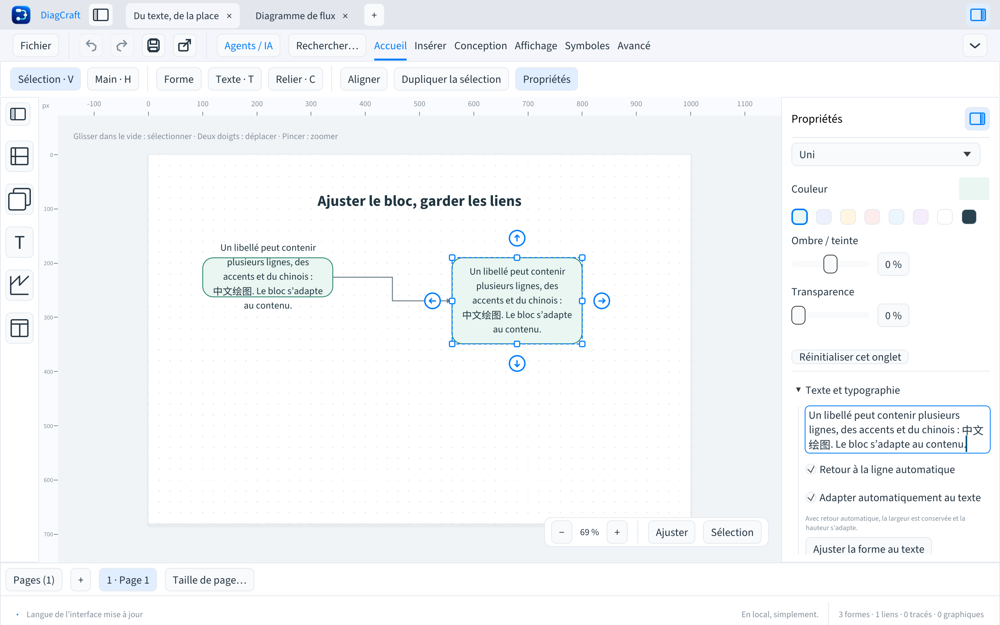

# Ajuster une forme au texte

DiagCraft 0.5.0 mesure les polices embarquées pour adapter les blocs à leur contenu.
Les lignes et l’interlignage sont partagés par le canevas, l’export SVG et l’export PDF.
Le calcul tient compte des lettres étroites ou larges, du gras, de l’italique,
de la police monospace et du chinois. Les accents combinés ne sont pas séparés
par un retour à la ligne. Le texte original reste intact dans le document.

À gauche, un bloc aux dimensions fixes laisse déborder son libellé. À droite,
l’option automatique adapte la hauteur en conservant la largeur et les connexions.

## Ajuster une fois

Sélectionner une ou plusieurs formes, puis choisir **Ajuster la forme au texte**
dans le menu contextuel, la palette ⌘K / Ctrl+K ou **Texte et typographie** dans
les propriétés. Pour plusieurs formes, le bouton s’appelle **Ajuster les formes au texte**.

- Avec **Retour à la ligne automatique**, la largeur est conservée et la hauteur s’adapte.
- Sans retour automatique, les deux dimensions sont calculées à partir des lignes explicites.
- Si un seul graphème ne tient pas, la largeur est augmentée juste assez pour l’accueillir.

Chaque forme utilise son propre texte et son propre style. Les autres objets de
la sélection restent intacts. L’opération complète s’annule avec ⌘Z / Ctrl+Z.

## Adapter pendant la saisie

Dans **Texte et typographie**, cocher **Adapter automatiquement au texte**.
Le retour à la ligne est activé en même temps. La hauteur s’adapte ensuite à la
saisie et aux changements de police ou de taille. Décocher le retour automatique
permet d’adapter aussi la largeur.

L’option est enregistrée dans chaque forme. Elle est désactivée pour les dessins
existants. Le coin supérieur gauche et les identifiants sont conservés ; les liens
suivent leurs points de connexion. Redimensionner manuellement une forme, avec
ses poignées ou ses champs de dimensions, désactive l’option. Annuler ce geste
restaure également le réglage automatique.

## Exports et agents

Source Sans 3, Hack et Noto Sans SC servent au calcul. Le PDF embarque les polices
nécessaires. Le SVG conserve des textes éditables avec les mêmes retours et
coordonnées ; son lecteur doit disposer de ces polices pour retrouver les mêmes
métriques. Une substitution de police peut changer l’apparence. Les marges
centrales réservent de la place aux côtés inclinés ou courbes des formes.

L’API agents expose `text_style.auto_fit`. Les patches ajustent les nœuds concernés
avant le calcul de la révision de résultat. L’inspection fournit `text_layout`
avec les lignes, la taille calculée, la zone de texte et l’indicateur de débordement.
Voir [le contrat agents](AGENTS-DRAW.md).

Le document reste au format **v7**, l’API agents en **v1**. Les anciennes applications
peuvent lire les dimensions enregistrées mais ignorent l’option automatique.
L’ajustement refuse un texte nécessitant une dimension supérieure à 20 000 px :
réduire son contenu, sa taille de police ou le répartir entre plusieurs blocs.
