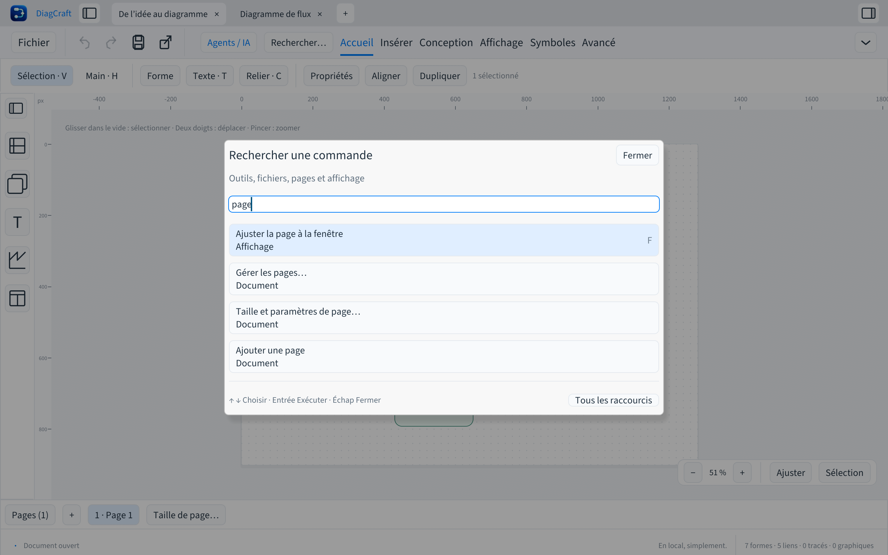
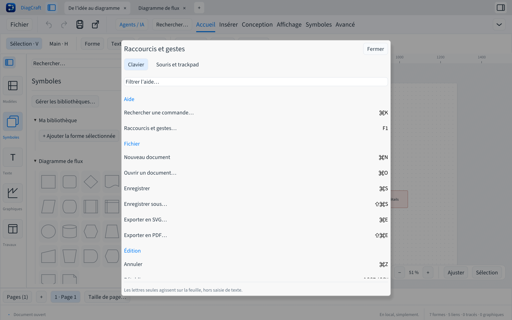

# Commandes et raccourcis

Ouvrir **Rechercher…** dans la barre du haut, ou utiliser **⌘K sur Mac** et
**Ctrl+K sur Windows/Linux**. La palette retrouve les fichiers, outils, exports,
pages, propriétés, bibliothèques et fonctions pour les agents.

Écrire quelques mots, par exemple `export pdf`, `taille page`, `proprietes`
ou `chatgpt`. Accents et majuscules sont facultatifs. Les flèches ↑ / ↓ choisissent
une commande disponible ; **Entrée** l’exécute. Un clic sur un résultat fonctionne
aussi. **Tab / Maj+Tab** parcourent les contrôles. **Échap** ferme la palette et
conserve la sélection. Les commandes grisées indiquent ce qu’il manque, par
exemple une sélection ou une modification à annuler.

## Aide clavier

**F1** ouvre l’aide, également disponible dans la palette et l’onglet Avancé.
Sur un Mac configuré pour les touches multimédias, utiliser **fn+F1**.
Le filtre retrouve une action ou un raccourci. Les raccourcis affichés utilisent
⌘ sur Mac et Ctrl sur Windows/Linux. L’onglet **Souris et trackpad** décrit
les déplacements, le zoom, les sélections et le redimensionnement.

Les lettres seules, comme R pour un rectangle et C pour un connecteur,
s’appliquent à la feuille hors saisie de texte. Pendant une saisie, copier,
coller et annuler restent gérés par le champ. Enregistrer, ouvrir, créer et
exporter restent accessibles avec leurs raccourcis. Une boîte de dialogue
ouverte bloque les commandes du dessin qui se trouve derrière elle.

Les commandes de modification suivent le même historique que les boutons de
l’éditeur. Le zoom, les volets et la recherche ne modifient pas le document.
Fermer un document modifié propose toujours de conserver le travail.

## Texte dans les blocs

Double-cliquer dans un bloc place le curseur sur la feuille. **F2** ou **Entrée**
sur un bloc sélectionné ouvre la même saisie en sélectionnant son texte.
**Entrée** ajoute ensuite une ligne. Un clic à l’extérieur ou **⌘Entrée / Ctrl+Entrée**
termine ; **Échap** annule. **⌘S / Ctrl+S** valide puis enregistre.
Les autres commandes du dessin attendent la fin de cette saisie.
Voir [le contenu des blocs](contenu-blocs.md) pour les styles et la sélection.

## Rechercher et placer au clavier

**⌘F / Ctrl+F** retrouve les objets de la page par texte, type ou identifiant.
Les flèches choisissent un résultat, **Entrée** le sélectionne, **Maj+Entrée**
l’ajoute à la sélection et **F2** modifie directement son texte.
**R / T**, puis **Entrée**, place un rectangle ou un texte dans la zone visible.
Avec deux blocs sélectionnés, **C** crée leur lien.
Voir [le parcours complet](recherche-objets.md).
