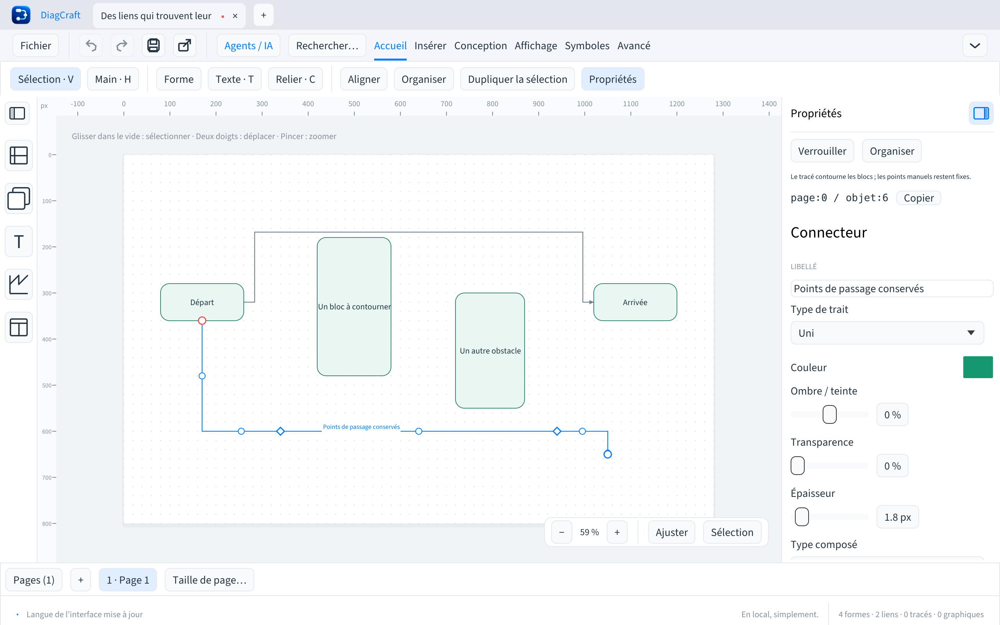

# Connecteurs et obstacles

Depuis DiagCraft 0.9.0, les connecteurs **à angle droit** contournent les enveloppes
rectangulaires des blocs et graphiques visibles. Le canevas, l’aperçu de création,
l’inspection CLI/MCP, le SVG et le PDF utilisent le même moteur.

## Relier puis ajuster

1. Reliez deux blocs par leurs poignées, ou utilisez l’outil Relier.
2. Choisissez les côtés de départ et d’arrivée dans les propriétés si nécessaire.
3. Faites glisser une poignée de segment pour imposer un point de passage.
4. Déplacez les losanges pour ajuster ces points ; Alt désactive le magnétisme.

Ajouter un point ne fige que ce point. Les détours automatiques restent libres
de s’adapter entre les points imposés. Les points existants sont conservés dans
leur ordre et à leurs coordonnées exactes, y compris s’ils sont alignés. Leurs
coordonnées X/Y restent modifiables dans les propriétés. Une extrémité libre
reste à sa position quand le bloc attaché à l’autre extrémité se déplace.

Les points ajoutés et leurs déplacements sont annulables. Le magnétisme porte
sur le déplacement : un point situé hors grille ne saute pas au début du geste.
Le mode automatique du menu contextuel retire les points manuels explicitement.
Le mode manuel peut figer les coudes d’un tracé simple ; au-delà de 16 points,
ajoutez plutôt les seuls points dont vous avez besoin.

## Ce qui reste fixe

Les côtés explicitement choisis, les points manuels, les extrémités libres et le
texte du lien ne sont jamais déplacés ou réécrits par le routage. La position du
libellé suit la même fraction de longueur du nouveau tracé ; elle n’est pas
figée à une coordonnée absolue. Les lignes directes restent directes.

Les calques masqués ne créent pas d’obstacles. Les objets Texte, Cadre et Couloir
sont des annotations ou conteneurs et n’obstruent pas les liens. Le contour réel
d’une forme concave n’est pas utilisé : le moteur garde une marge autour de son
enveloppe rectangulaire. Une marge réduite permet les passages étroits près des
points imposés et des ports.

## Contraintes et limites

Si un point est imposé **à l’intérieur d’un bloc**, ou si un port est obstrué par
un bloc qui le chevauche, il peut être impossible de tout contourner. Les
coordonnées sont conservées et les propriétés signalent le passage bloqué.
Déplacez alors le bloc, le point ou l’extrémité. Le moteur autorise l’entrée et
la sortie du bloc contenant un point imposé uniquement pour les portions qui
rejoignent ce point.

Le calcul est déterministe, sans dépendre du zoom ou d’un historique de caméra.
Des voies espacées de 8 px, une préférence pour moins de coudes et une tolérance
de 16 px sur les longueurs comparables réduisent les changements de côté lors
de petits déplacements. Un obstacle qui ferme réellement un passage peut
nécessiter un changement de trajet.

La recherche est bornée à 24 000 états par connecteur, même avec 16 points
manuels. Le graphe utilise les voies des 34 obstacles les plus proches ; tous
les obstacles restent contrôlés. Si aucun trajet représentable n’est trouvé,
le moteur utilise un trajet simplifié, sans déplacer les points imposés, et
l’inspecteur le signale. Il ne garantit pas de trouver tous les chemins possibles
dans un labyrinthe très dense. Les croisements entre connecteurs et les collisions
de libellés ne sont pas évités dans cette version.

## Agents et fichiers

Le format `.draw` reste v7 et l’API reste v1. Aucun champ de route calculée n’est
ajouté aux fichiers ; les points manuels existants restent inchangés. Les anciennes
versions ouvrent les fichiers mais calculent leurs anciens tracés, sans évitement
des blocs. Utilisez 0.9.0 ou plus pour retrouver le même rendu.

L’inspection ajoute `routing_status` aux connecteurs : `clear`, `constrained`,
`limited`, ou `direct`. Les diagnostics non bloquants `route_constrained` et
`route_limited` fournissent la page et l’ID. `route` et `label_position` sont des
valeurs dérivées : les agents modifient les extrémités, ports ou `waypoints`,
pas ces résultats calculés. Voir [le guide agents](AGENTS-DRAW.md).

## Insérer une étape directement sur une liaison

Dans la branche de développement, choisissez une forme dans la bibliothèque,
puis survolez une liaison : un trait bleu et un repère **+** indiquent la cible.
Cliquez pour insérer le bloc à cet endroit. Le connecteur devient deux liaisons ;
son libellé reste sur la première et les styles/extrémités sont conservés.
Les points manuels sont répartis de part et d’autre du nouveau bloc.
Cmd/Ctrl+Z annule l’insertion entière en une action.

Si le segment manque de place, un message explique le refus ; aucun bloc isolé
n’est créé. Éloignez les blocs voisins puis recommencez. Le texte seul et les
symboles personnels gardent leur placement habituel ; les liaisons masquées ou
verrouillées ne sont pas ciblées. Le menu contextuel conserve aussi sa commande
d’insertion. Le placement au clavier avec Entrée garde son fonctionnement actuel.
