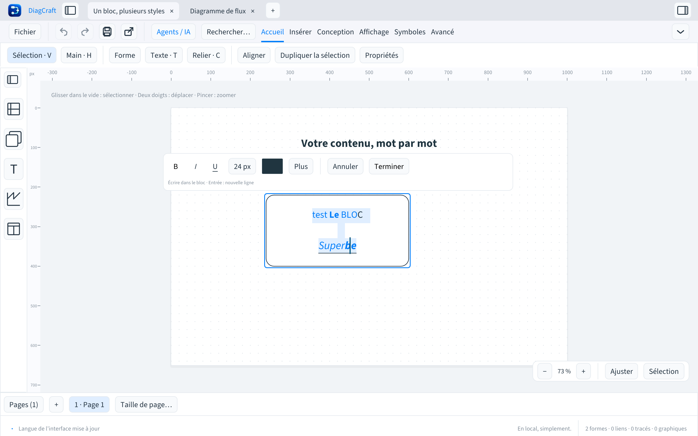
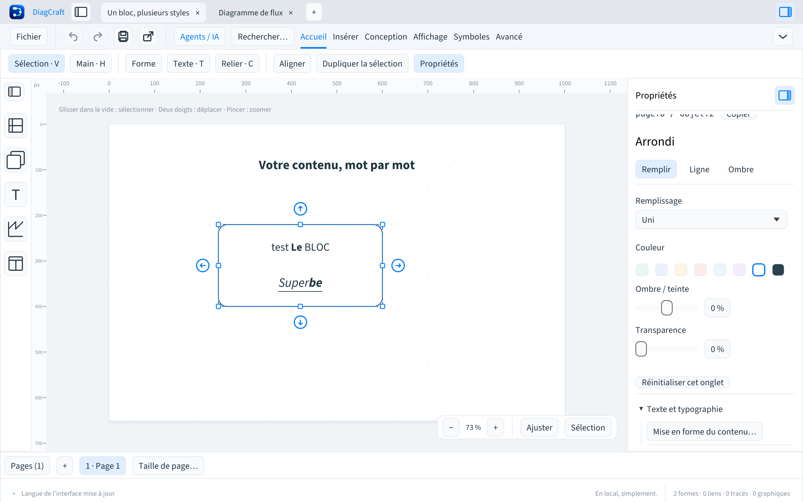

# Mettre en forme le contenu d’un bloc

Depuis DiagCraft 0.6.0, un bloc peut contenir plusieurs styles de texte : gras,
italique, souligné, barré, police monospace, tailles et couleurs différentes.
Le texte reste éditable ; aucun balisage HTML n’est interprété.

## Écrire directement dans le bloc

Depuis **0.6.1**, double-cliquer place le curseur à l’endroit choisi dans le bloc,
sur la feuille, sans fenêtre supplémentaire. On peut aussi sélectionner un bloc
puis appuyer sur **F2** ou **Entrée**, choisir **Modifier le texte** dans le menu
contextuel ou **Mise en forme du contenu…** dans les propriétés. Ces commandes
sélectionnent tout le texte pour le remplacer rapidement.

1. Sélectionner un mot ou une portion de texte avec la souris ou le clavier.
2. Utiliser **B**, **I**, **U**, la taille ou la couleur dans la petite barre flottante.
3. Cliquer à l’extérieur du bloc ou choisir **Terminer**. **Annuler** conserve le bloc original.

**Plus** donne accès au texte barré, à la police monospace, à l’alignement, au
retour automatique, à l’ajustement de la forme et à l’historique de saisie.
La barre reste dans la feuille même près de ses bords. Un clic sur un autre bloc
valide la saisie puis sélectionne ce bloc. Le zoom conserve la taille relative
du texte et la position du curseur ; le trackpad déplace la feuille hors de la
zone de saisie et fait défiler un long texte dans le bloc.

**Tout sélectionner** permet de modifier l’ensemble du texte. Les boutons de
style sont désactivés sans sélection ; le texte saisi hérite du style au point
d’insertion. **Entrée** ajoute une ligne, y compris une ligne vide entre deux
paragraphes. L’alignement et le retour automatique concernent tout le bloc.
**Effacer la mise en forme** rétablit, pour la sélection, le style de base du bloc.

L’aperçu sur la feuille suit le brouillon ; le document et sa copie de récupération
restent inchangés tant que l’on n’a pas terminé. Les positions, identifiants et
connecteurs restent conservés. Si l’ajustement automatique est activé, la forme
s’adapte aussi aux tailles de police choisies.

## Raccourcis

- **⌘B / Ctrl+B**, **⌘I / Ctrl+I**, **⌘U / Ctrl+U** : gras, italique, souligné sur la sélection.
- **⌘Z / Ctrl+Z** et **⌘⇧Z / Ctrl+Maj+Z** : annuler/rétablir dans l’éditeur, texte et styles ensemble.
- **⌘Entrée / Ctrl+Entrée** : terminer. **Échap** : annuler le brouillon.
- **⌘S / Ctrl+S** : terminer puis enregistrer ; avec Maj, enregistrer sous.

Après validation, une seule annulation du dessin restaure le contenu précédent.
Changer d’onglet ou fermer l’application valide d’abord la saisie, avant les
confirmations habituelles d’enregistrement. Le dernier caractère est conservé
même si un clic ou un raccourci arrive dans la même image.
Le champ de texte du volet reste également éditable et préserve les styles des
parties inchangées. Le presse-papiers texte du système insère du texte brut ; la
copie de blocs dans DiagCraft conserve leurs styles.

## Enregistrement, exports et agents

Les portions mises en forme sont enregistrées dans le champ facultatif `text_runs`
du nœud, en complément du texte brut. Le format reste **v7** et l’API agents **v1**.
Les anciens dessins restent inchangés. Une application plus ancienne ignore ces
portions et affiche le texte avec le style de base ; réenregistrer avec elle perd
les styles par portions.

Le SVG utilise des `tspan` éditables. Le PDF conserve le texte sélectionnable et
ses polices embarquées. Le lecteur SVG doit disposer des polices utilisées.
La coupe des lignes et l’ajustement tiennent compte des styles et tailles de
chaque portion. Les accents combinés et séquences emoji ne sont pas séparés par
une frontière de style. La présence d’un glyphe dépend des polices embarquées.

L’API permet de remplacer `text_runs`, ou de conserver les styles en ne changeant
que `text`. Les plages sont en caractères Unicode, fin exclue, et non en octets
UTF-8. Elles doivent être ordonnées, sans chevauchement et aux frontières de
graphèmes. Maximum : 1 024 portions, texte de 65 536 octets, tailles de 6 à 200 px.
Voir [le contrat agents](AGENTS-DRAW.md).
