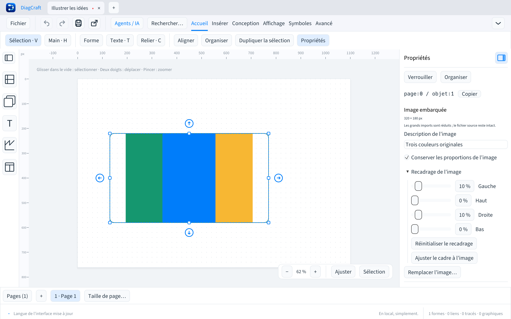
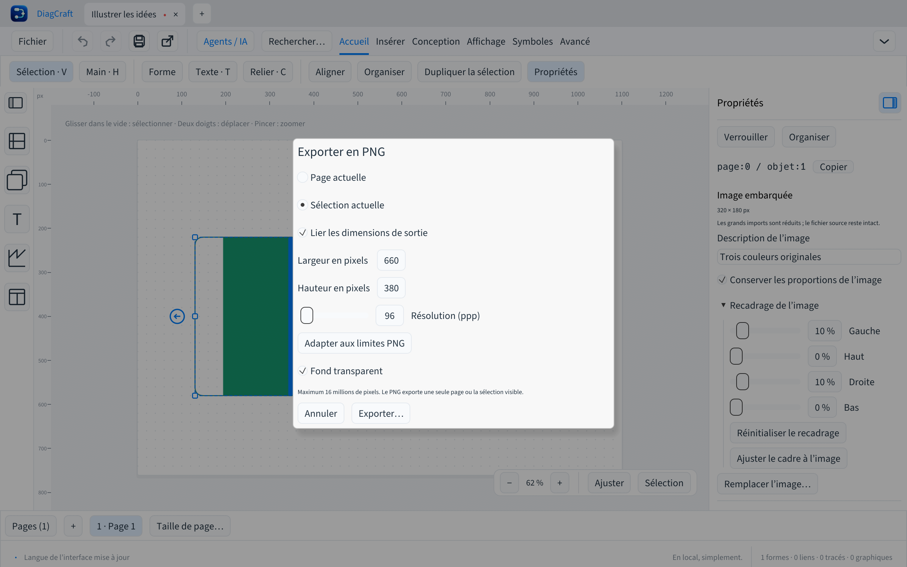

# Images et export PNG

DiagCraft 0.10.0 importe des images **PNG et JPEG**, les embarque dans les fichiers
`.draw`, permet leur recadrage et exporte une page ou une sélection en PNG.



## Importer et coller

- **Insérer → Importer des images…**, ou **⌘/Ctrl+I** : choisir un ou plusieurs fichiers.
- Déposer des fichiers PNG/JPEG sur la feuille : les images sont importées ensemble.
- **Insérer → Coller une image**, ou **⌘/Ctrl+Maj+I** : lire les pixels du presse-papiers natif.
  La commande Coller des menus essaie aussi une image avant le texte.
  Le raccourci dédié est recommandé pour les images, le collage natif ⌘/Ctrl+V
  étant traité comme du texte par le backend actuel.

Le collage dépend des formats fournis par le presse-papiers du bureau. Si aucune
image n’est disponible, importer ou déposer le fichier reste possible. La saisie
à l’intérieur d’un bloc conserve son collage de texte habituel.

Les grandes images sont réduites automatiquement pour rester dans les limites
ci-dessous. Le fichier source n’est jamais modifié ; seules les données
normalisées sont embarquées. PNG/JPEG sont décodés puis enregistrés en PNG RGBA,
sans dépendance à un chemin externe. L’orientation JPEG est appliquée ; les
métadonnées d’origine ne sont pas conservées. Les animations ne sont pas animées :
seule l’image décodée est importée. Les profils colorimétriques avancés et les
formats RAW ne sont pas pris en charge.

## Manipuler et recadrer

Les images se sélectionnent, se déplacent et se redimensionnent comme les blocs.
Elles peuvent appartenir à un groupe ou à un calque, être verrouillées et recevoir
des connecteurs. Leur description est recherchable dans le filtre **Images**.

Dans les propriétés :

1. Donner une **description** à l’image.
2. Garder ou désactiver **Conserver les proportions de l’image**.
3. Ouvrir **Recadrage de l’image** et régler les marges gauche, haute, droite et basse.
4. Utiliser **Réinitialiser le recadrage** pour retrouver toute l’image normalisée,
   ou **Ajuster le cadre à l’image** pour adapter ses dimensions.

Le recadrage ne supprime pas les pixels embarqués. Les formes, contours et ombres
restent utilisables ; une forme arrondie ou elliptique masque l’image suivant son
contour. Une description ne s’affiche pas sur la feuille. Le texte du bloc peut
être utilisé séparément pour une légende, avec les outils de texte habituels.

L’import groupé, les changements de recadrage, le remplacement et les gestes
sont annulables. Copie, duplication, pages, bibliothèque, galerie et récupération
conservent les données embarquées.

## Exporter une page ou une sélection

**Fichier → Exporter en PNG…** ouvre les réglages :

- Page actuelle ou sélection visible, avec expansion des groupes.
- Largeur et hauteur en pixels, liées ou indépendantes.
- Résolution de **36 à 1200 ppp**, enregistrée dans le champ PNG `pHYs`.
- Fond transparent, ou couleur de fond de la page.
- **Adapter aux limites PNG** pour réduire les dimensions sans changer leur ratio.



Le réglage de résolution initialise les pixels depuis la géométrie à 96 dpi.
Des dimensions saisies manuellement peuvent ensuite fixer un autre format ;
les délier permet un étirement volontaire. La transparence retire le fond de
page ; les fonds des objets et des libellés restent ceux du dessin.

Un PNG contient une seule page ou sélection. Le PDF reste disponible pour un
export multipage. Le PNG utilise les mêmes textes, images recadrées, styles et
routes que le SVG et le PDF. Une sélection de connecteurs conserve le détour
calculé autour des blocs non exportés. Les calques masqués ne sont pas exportés.

## Limites de ressources

| Ressource | Limite |
| --- | --- |
| Fichier importé | 8 Mio, PNG ou JPEG |
| Pixels en entrée | 16 millions, 8192 px maximum par côté |
| Image embarquée après réduction | 4 millions de pixels et 4 Mio de PNG |
| Données d’images par document, toutes pages | 16 millions de pixels et 8 Mio de texte base64 |
| Import simultané | 16 images, application atomique |
| Document `.draw` complet | 16 Mio |
| Export PNG | 16 millions de pixels, 8192 px maximum par côté |

Les copies comptent dans les budgets du document. Les pixels sont partagés en
mémoire entre les états d’annulation via une charge immuable ; le fichier JSON
reste autonome et contient chaque occurrence. Les budgets globaux sont contrôlés
avant décompression des images d’un document chargé. Une image malformée ou un
lot trop grand est rejeté sans insertion partielle.

## Fichiers et agents

Le format reste **v7**, l’API agents **v1**. Les anciens documents sans image
conservent leur sérialisation et leur révision. Les applications antérieures à
0.10.0 ignorent les images et les perdent au réenregistrement : utilisez une
version récente pour modifier un document illustré.

Les opérations `add_image` et `update_image` utilisent une charge PNG base64,
un alias ou ID de nœud, et un recadrage `[x, y, largeur, hauteur]` normalisé dans
`[0,1]`. Les agents peuvent déplacer et styler ces objets avec `update_node`.
L’inspection expose type `image`, position, dimensions, recadrage, description et
SHA-256 ; elle omet les pixels base64 pour limiter le contexte.

```sh
diagcraft-cli --import-image entree.draw capture.png illustre.draw 80 120
diagcraft-cli --export-png illustre.draw page.png --width 1600 --dpi 144 --transparent
diagcraft-cli --export-png illustre.draw selection.png --selection 12,15 --width 1200
diagcraft-cli --export-png illustre.draw page-2.png --page 1 --width 1600
diagcraft-cli --images-demo exemple.draw
```

`--page` est indexé à partir de 0 ; les IDs de sélection sont propres à cette
page. Avec une seule dimension fournie, l’autre conserve le ratio. L’import CLI
écrit un nouveau document et refuse de remplacer une sortie existante. Les
images des démonstrations sont des aplats synthétiques originaux générés par le
projet ; aucune photo tierce n’est distribuée.
