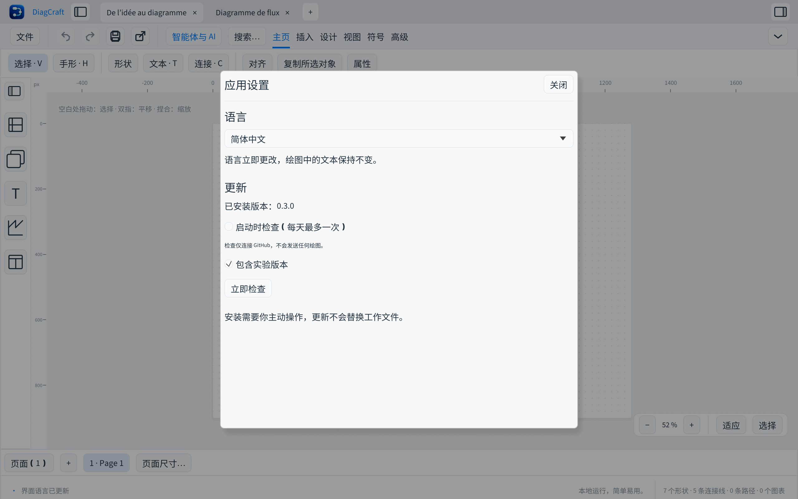

# Langues et mises à jour



## Choisir la langue

Ouvrir **Fichier → Langue et paramètres…** ou rechercher « langue » dans la
palette ⌘K / Ctrl+K. Sept choix sont disponibles : English, Français, Deutsch,
Español, Italiano, Português et 简体中文 (chinois simplifié).

Le changement est immédiat. **Système** suit la langue du système parmi les
langues prises en charge ; sinon l’anglais est utilisé. Les variantes régionales
allemandes, espagnoles et portugaises partagent leur traduction. Le chinois
traditionnel n’a pas encore de catalogue distinct.

Les préférences sont locales à l’utilisateur, séparées des fichiers `.draw`.
Les titres, pages, textes, légendes et contenus saisis dans les diagrammes ne sont
jamais traduits lors d’un changement de langue. Les modèles de démonstration et
certains diagnostics techniques du moteur conservent leur contenu d’origine.
Les nouveaux libellés par défaut créés dans l’interface utilisent la langue active.

Noto Sans SC est embarquée sous licence OFL pour les caractères chinois, y compris
les exports PDF. Aucun téléchargement de police n’est nécessaire. Les exports SVG
référencent cette police ; leur affichage dépend des polices disponibles chez le lecteur.

Pour tester une langue ou produire une capture reproductible :

```sh
cargo run --locked -p diagcraft -- --language de
cargo run --locked -p diagcraft -- --language zh-Hans --screenshot capture.png parametres
```

## Mettre à jour

**Fichier → Vérifier les mises à jour…** interroge les releases publiées du seul
[dépôt DiagCraft](https://github.com/Kevin-FR/DiagCraft/releases). La vérification
automatique au démarrage est **désactivée par défaut**. Si elle est activée, elle
a lieu au plus une fois par jour. Elle s’exécute en arrière-plan et n’ouvre pas
une fenêtre pendant le dessin.

Le canal peut inclure les versions expérimentales, ce qui est activé par défaut
pendant la phase 0.x. Les brouillons, versions anciennes et paquets destinés à une
autre plateforme sont ignorés. La comparaison utilise SemVer, pas un tri de texte.

« Télécharger le paquet vérifié… » demande un emplacement. Le fichier reste
temporaire tant que sa taille et son SHA-256 n’ont pas été vérifiés avec
`SHA256SUMS.txt` et, si disponible, le digest de l’API GitHub. Un échec ou une
annulation avant validation préserve le fichier déjà présent. Les téléchargements
sont limités à 256 Mio. Ces empreintes vérifient l’intégrité ; elles ne remplacent
pas une signature éditeur.

**L’installation est manuelle** : enregistrer ses dessins, quitter DiagCraft,
puis installer le paquet téléchargé. Aucun document, préférence ou exécutable
en cours d’utilisation n’est remplacé automatiquement. Le paquet Mac proposé
est exclusivement Apple Silicon ; Linux x86_64 reçoit le `.deb` et Windows
x86_64 le ZIP portable. Les autres architectures peuvent utiliser la page des releases.

La requête HTTPS transmet à GitHub les données habituelles de connexion, dont
l’adresse IP et un User-Agent indiquant la version de DiagCraft. Elle ne contient
aucun dessin, chemin de fichier, identifiant utilisateur ni clé API. Aucun compte
GitHub n’est requis. Une limite de requêtes ou une absence de connexion est
signalée dans les paramètres ; il est possible de réessayer manuellement.

Le transport utilise le curl du système, avec configuration personnelle désactivée.
macOS 13+ et Windows 10/11 le fournissent ; le paquet Debian déclare `curl` et
`ca-certificates` comme dépendances. Une archive Linux nécessite ces outils.

## Contribuer aux traductions

`assets/locales/messages.json` contient un objet par libellé source, avec les sept
codes `en`, `fr`, `de`, `es`, `it`, `pt`, `zh-Hans`. Les clés françaises servent de
référence interne à l’interface ; elles ne sont pas des identifiants de document.
Conserver exactement les substitutions `{0}`, `{1}`, etc. Le programme insère
les valeurs après traduction, sans traduire ni interpréter le texte utilisateur.

Exécuter `python3 scripts/check-locales.py` et `cargo test --locked --workspace`.
La CI vérifie les langues manquantes, les substitutions et les clés utilisées par
l’interface. Tester également les libellés longs dans une fenêtre de 1200 × 760.
Une relecture par des locuteurs natifs reste bienvenue.
