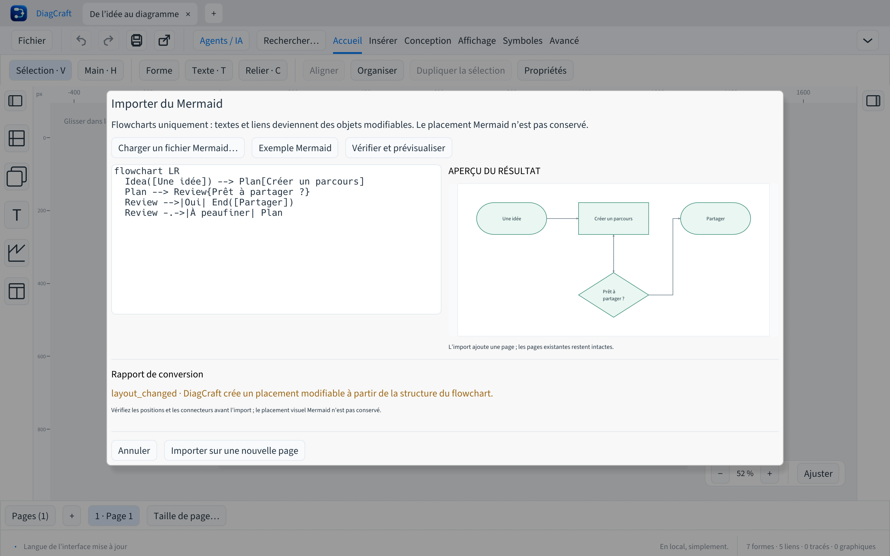
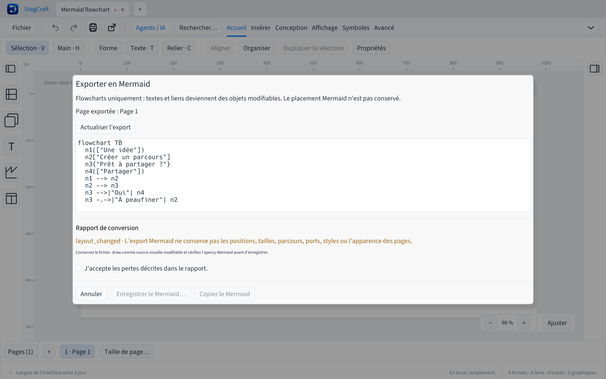

# Mermaid — diagrammes de flux (0.11.0)

Le contrat de ce sous-ensemble a été défini avant implémentation. DiagCraft traite le texte
comme une donnée locale ; il n’exécute ni JavaScript, ni HTML, ni directive réseau.
La [syntaxe officielle des flowcharts](https://mermaid.js.org/syntax/flowchart.html)
sert de référence. Aucun code ni ressource Mermaid n’est incorporé.

## Import pris en charge

- Un seul `flowchart` ou `graph`, avec direction `TB`, `TD`, `BT`, `LR` ou `RL`.
- Identifiants ASCII : lettre ou souligné initial, puis lettres, chiffres et soulignés.
- Déclarations de nœuds seules ou dans une chaîne de liens ; références implicites.
- Formes classiques : rectangle `A[texte]`, arrondi `A(texte)`, terminal
  `A([texte])`, décision `A{texte}`, cercle `A((texte))`, hexagone `A{{texte}}`,
  sous-processus `A[[texte]]`, base de données `A[(texte)]`.
- Texte brut ou entre guillemets doubles, Unicode ; entités numériques pour
  caractères réservés, et `<br>`, `<br/>`, `<br />` pour un retour à la ligne.
- Liens `-->`, `---`, `-.->`, `==>` ; libellé optionnel `-->|texte|` (même
  notation après les autres liens). Chaînes `A --> B --> C`.
- Instructions séparées par retour à la ligne ou point-virgule, commentaires `%%`.
- Au maximum 256 Kio de source, 200 nœuds, 400 liens et 4096 caractères par libellé.
  Le format v7 limite en plus les libellés de liens à 4096 octets UTF-8.

Les types autres que flowchart, sous-graphes, styles/classes, clics, directives,
front matter, HTML autre que les retours à la ligne, Markdown enrichi, formes
étendues `@{...}`, liens multiples `&`, animations, ports et flèches exotiques
et les auto-liens vers le même nœud sont refusés avec emplacement et piste de correction. Aucune instruction
inconnue ne doit être silencieusement ignorée. Les commentaires ordinaires sont
ignorés, les directives `%%{...}%%` sont refusées.

Les textes et relations deviennent des objets DiagCraft modifiables. Le placement
est déterministe et borné, adapté à la direction ; il n’a pas vocation à reproduire
la mise en page de Mermaid. L’import signale cette différence avant application.
Les retours à la ligne sont conservés ; le balisage n’est jamais rendu comme HTML.
Les identifiants Mermaid deviennent des IDs numériques locaux ; l’export emploie
`n<ID>`. Les libellés longs peuvent nécessiter un ajustement de taille après import.

## Export pris en charge

Une page choisie, objets visibles uniquement. IDs stables dérivés des IDs locaux,
textes et formes compatibles, liens attachés entre nœuds, libellés et motifs
simples. Les liens non orientés et les flèches de fin sont représentables.
Le résultat doit être réimportable par ce même sous-ensemble.

Un rapport préalable expose les objets omis et les conversions : autres formes
vers rectangle, images/texte enrichi vers texte brut, graphiques/tracés et liens
libres omis, groupes/calques/styles et géométrie non conservés. La sortie n’est
écrite qu’après validation explicite de ces pertes. Le `.draw` source reste intact.
Le format `.draw` reste v7 et l’API de patches reste v1.



## Parcours dans l’application

Ouvrir la commande d’import Mermaid depuis Fichier, Insérer ou la palette de
commandes. Charger un fichier `.mmd` ou coller sa source, puis demander l’aperçu.
Les erreurs désignent la ligne et la colonne ; les avertissements précisent les
limites de conversion. La source et le document ouvert restent intacts pendant
cet examen. L’application ajoute le résultat dans une **nouvelle page** ; un seul
Annuler retire cet import. Une modification du document entre aperçu et validation
impose un nouvel aperçu.

L’export porte sur la page actuelle. Examiner le texte et le rapport avant de
copier ou enregistrer ; confirmer explicitement les pertes annoncées. Un fichier
Mermaid décrit les textes et relations, pas une copie fidèle des pixels.
Conserver le `.draw` comme source éditable complète.



## CLI locale

```sh
diagcraft-cli --import-mermaid schema.mmd schema.draw --dry-run
diagcraft-cli --import-mermaid schema.mmd schema.draw --accept-losses
diagcraft-cli --export-mermaid schema.draw schema-export.mmd --page 0 --dry-run
diagcraft-cli --export-mermaid schema.draw schema-export.mmd --page 0 --accept-losses
```

Le dry-run n’écrit aucun fichier ; le JSON expose `diagnostics`,
`requires_confirmation` et le contenu proposé (`preview` pour l’import, `source`
pour l’export). Sans `--accept-losses`, une conversion comportant des avertissements
refuse d’écrire. L’avertissement de mise en page est donc à examiner aussi à l’import.
Les chemins de sortie doivent être **nouveaux** ; les fichiers existants, y compris
la source, ne sont jamais écrasés. Les pages sont indexées à partir de 0.

La CLI et l’application utilisent le même moteur. Les quatre outils MCP restent
ceux de l’API de patches ; un agent peut utiliser cette CLI pour convertir du
Mermaid, puis inspecter et modifier les objets obtenus par les outils habituels.
Voir aussi [les diagnostics agents](diagnostics.md).

L’exemple [mermaid-flowchart.mmd](../examples/mermaid-flowchart.mmd) est une création
originale du projet, sous MIT. Aucun navigateur ni service distant n’est nécessaire.

Les commandes et le rapport courant de mise en page sont localisés dans les sept
langues. Les autres détails techniques de conversion sont actuellement en anglais,
avec des codes stables et un emplacement dans la source.
