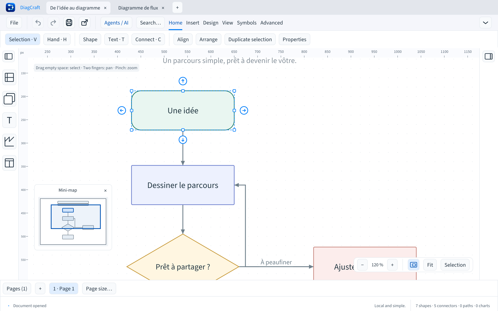

# Mini-map navigation

DiagCraft 0.12.1 adds an optional overview of the active page. Open it with the
small page-and-viewport icon beside the zoom controls, **View → Panels and
ribbon → Mini-map**, or the **Show / hide the mini-map** command in the command
palette (Cmd+K / Ctrl+K). Its visibility is a local interface preference and is
hidden by default. The close button hides it; the zoom-bar icon stays available.
Resetting the interface restores the hidden default.

## Moving around

- Click a location in the overview to centre the main view there.
- Drag the blue viewport frame to pan while keeping the point you grabbed under
  the pointer. Dragging elsewhere moves the view towards that location.
- Focus the navigation surface with Tab or click it. Arrow keys pan by 10% of
  the visible area; Shift+arrows use 25%. These keys move the camera, not the
  selected objects. Home fits the page. Escape cancels an active mini-map drag
  and restores its starting view.

Clicking and dragging keep the current zoom. The overview projection is based
on the page and visible diagram content, independently of the camera. It stays
stable while panning, including when the main view moves outside the page.
A blue dot at the overview edge indicates a view wholly outside the drawing.
Home or a click on the page brings it back.

The overview uses simplified silhouettes: rectangles for most blocks, text,
images and charts, with special outlines for ellipses and decisions, and lines
for paths and connectors. Selected objects use a stronger outline. The page
boundary remains visible. Hidden layers and links attached to hidden blocks are
excluded; locked objects remain visible. Content outside the page contributes
to the overview bounds. Switching pages or documents shows the new active page.

## Drawing and interface state

Mini-map navigation does not edit the diagram, selection, saved/modified state,
or undo/redo history. Its visibility is not saved in `.draw`, and it does not
appear in SVG, PDF or PNG exports. The drawing format remains **v7**, the agent
patch API remains **v1**, and no dependency is added.

The overview temporarily disappears while a drawing gesture, arrow-key object
move, inline text edit, context menu or modal dialog has priority. It returns
when that interaction ends. A mini-map drag stops if its page, document,
projection, panel geometry or focus changes. Its release is consumed so it
cannot start a drawing gesture behind the overview. Pointer clicks, middle
button and trackpad navigation over the visible overview are kept separate
from canvas input.

The panel stays inside the canvas, above the bottom zoom controls. Its size is
bounded and it hides temporarily if the canvas is too small to contain it.
The underlying drawing is still reachable after closing the overview. Interface
labels and accessible control names are translated in all seven languages.

## Validation and limits

Painting and event regressions cover clicks, drag offsets and releases outside
the panel, keyboard navigation, drawing-tool isolation, page/layer visibility,
preferences and small-window geometry. The implementation reuses cached routes
and paints simple primitives without text layout, image decoding or document
export for the overview.

These automated checks and the native rendering capture do not replace real-user
small-screen and screen-reader workflows. Full accessibility validation remains
part of the [1.0 quality work](quality.md). See also the
[keyboard guide](keyboard-navigation.md) and [interface guide](interface.md).
