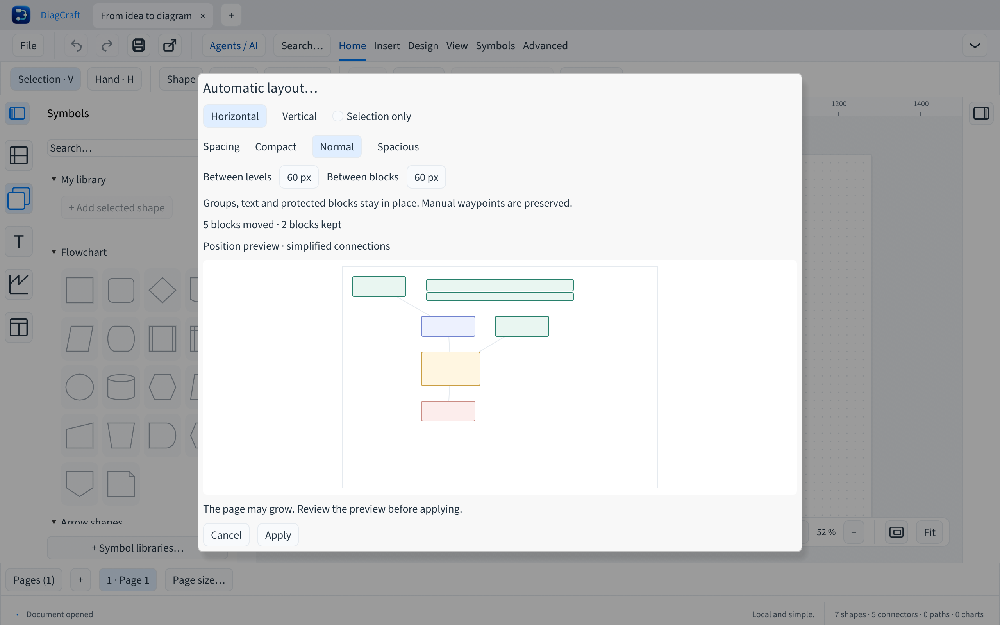

# Mise en page automatique des flux

Fonction disponible dans la branche de développement, non encore distribuée.
Ouvrez **Organiser → Mise en page automatique…**, ou recherchez cette commande
dans la palette Cmd/Ctrl+K. Choisissez Horizontal ou Vertical. Avec une sélection,
la case « Sélection uniquement » est cochée ; décochez-la pour la page active.

L’aperçu ne modifie pas le dessin. Il montre les positions proposées avec des
rectangles et des liaisons simplifiées ; les textes, contours détaillés et parcours
réels des connecteurs ne sont pas reproduits. Le nombre de blocs déplacés et
conservés est indiqué. **Appliquer** valide le lot, puis ajuste la vue ; Cmd/Ctrl+Z
annule l’ensemble. **Annuler**, Échap ou un clic extérieur ferme l’aperçu sans
modification. La page peut s’agrandir pour contenir le résultat.

Les blocs verrouillés, masqués, groupés et les textes libres restent à leur place.
Les blocs non sélectionnés restent aussi fixes. Les boîtes des blocs visibles et
graphiques fixes sont évitées. Les dessins libres restent inchangés mais ne sont
pas des obstacles de placement. Les autres pages ne changent pas.

Le graphe des blocs à déplacer donne des niveaux. Les boucles sont regroupées
dans un même niveau ; les blocs déconnectés sont aussi disposés. Le résultat est
déterministe à données et réglages égaux, avec une marge de 40 px.

Les préréglages **Compact**, **Normal** et **Aéré** choisissent respectivement
30, 60 ou 120 px pour les deux espacements. Vous pouvez régler séparément :

- **Entre les niveaux** : distance entre étapes successives du flux, dans le sens
  horizontal ou vertical choisi.
- **Entre les blocs** : distance entre blocs d’un même niveau, sur l’autre axe.

Les champs acceptent de 20 à 300 px. L’aperçu se recalcule à chaque changement ;
les obstacles fixes gardent leur position. Les réglages concernent l’aperçu
courant et reviennent à 60 px à la prochaine ouverture. Ils ne sont pas enregistrés
dans le document. Le calcul par défaut conserve le placement de la première version.
Les connecteurs sont conservés : les routes automatiques suivent les blocs et
les points de passage manuels restent à leurs coordonnées, donc peuvent demander
une retouche. Les libellés, styles, IDs et appartenances aux calques sont conservés.

Cette première version traite au maximum 500 blocs éligibles. Une sélection
plus petite permet de travailler sur les grands dessins. Les dimensions trop
grandes sont refusées sans changement. Il ne s’agit pas d’un optimiseur de
croisements ; le déplacement des groupes reste prévu.

L’application vérifie le document source, la page et l’onglet avant validation.
Un aperçu périmé doit être actualisé. Les tests couvrent cycles, branches, blocs
fixes, sélection, multipage, espacements indépendants et invalides, annulation et
activation des préréglages dans les sept langues à
1200 × 680 points. Ils ne remplacent pas les essais utilisateurs.
Le format `.draw` reste v7 et l’API agents v1, sans dépendance ajoutée.
