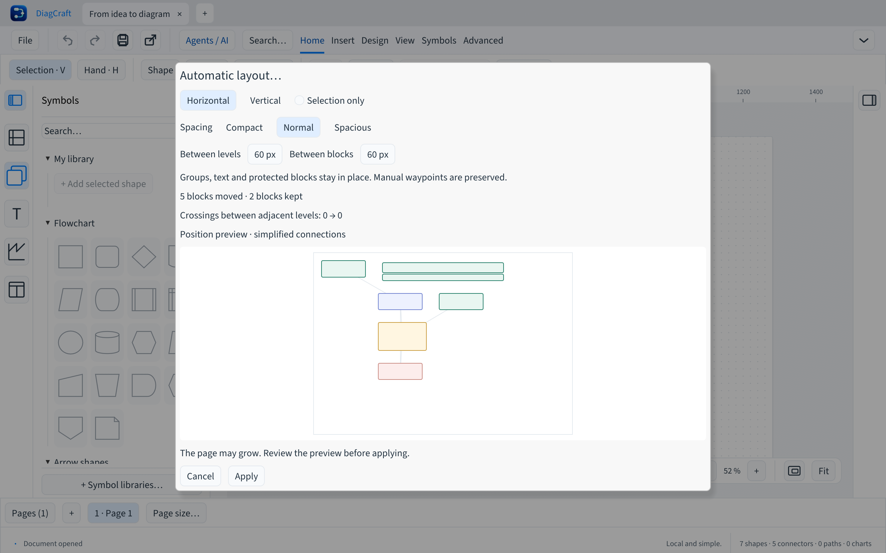

# Mise en page automatique des flux

Disponible depuis DiagCraft **0.13.1**.
Le déplacement des groupes décrit ci-dessous est présent sur la branche de
développement et n’est pas encore publié.
Ouvrez **Organiser → Mise en page automatique…**, ou recherchez cette commande
dans la palette Cmd/Ctrl+K. Choisissez Horizontal ou Vertical. Avec une sélection,
la case « Sélection uniquement » est cochée ; décochez-la pour la page active.

L’aperçu ne modifie pas le dessin. Il montre les positions proposées avec des
rectangles et des liaisons simplifiées ; les textes, contours détaillés et parcours
réels des connecteurs ne sont pas reproduits. Le nombre de blocs déplacés et
conservés est indiqué. **Appliquer** valide le lot, puis ajuste la vue ; Cmd/Ctrl+Z
annule l’ensemble. **Annuler**, Échap ou un clic extérieur ferme l’aperçu sans
modification. La page peut s’agrandir pour contenir le résultat.

Les blocs verrouillés, masqués et les textes libres isolés restent à leur place.
Les blocs non sélectionnés restent aussi fixes. Les boîtes des blocs visibles et
graphiques fixes sont évitées. Les dessins libres restent inchangés mais ne sont
pas des obstacles de placement. Les autres pages ne changent pas.

Un groupe compatible se déplace comme une seule unité, sans changer les écarts
entre ses membres. Il peut contenir des blocs, des images, des textes et des
connecteurs dont les deux extrémités sont attachées à des blocs du groupe ; il
doit contenir au moins un bloc autre qu’un texte. Sélectionner un de ses membres
suffit à inclure le groupe entier. Tous les membres doivent être visibles et
modifiables : si un membre est protégé ou masqué, le groupe entier reste fixe.
Les groupes contenant un graphique, un dessin libre ou un connecteur vers
l’extérieur restent aussi fixes. Un groupe composé uniquement de textes reste
fixe. L’enveloppe utilisée pour le placement comprend les blocs du groupe et les
points manuels de ses connecteurs membres. Le compteur de blocs reste un compte
des blocs individuels, et non des groupes.

Le graphe des unités à déplacer donne des niveaux. Les boucles sont regroupées
dans un même niveau ; les blocs déconnectés sont aussi disposés. Le résultat est
déterministe à données et réglages égaux, avec une marge de 40 px.

Les préréglages **Compact**, **Normal** et **Aéré** choisissent respectivement
30, 60 ou 120 px pour les deux espacements. Vous pouvez régler séparément :

- **Entre les niveaux** : distance entre étapes successives du flux, dans le sens
  horizontal ou vertical choisi.
- **Entre les blocs** : distance entre blocs d’un même niveau, sur l’autre axe.

Les champs acceptent de 20 à 300 px. L’aperçu se recalcule à chaque changement ;
les obstacles fixes gardent leur position. Les réglages concernent l’aperçu
courant et reviennent à 60 px à la prochaine ouverture. Ils ne sont pas enregistrés
dans le document. Les espacements par défaut restent à 60 px.
Les routes automatiques des connecteurs suivent les blocs. Les points de passage
manuels des connecteurs membres d’un groupe compatible suivent sa translation.
Ceux des connecteurs hors du groupe restent à leurs coordonnées, même quand
leurs deux blocs appartiennent au même groupe ; ils peuvent demander une
retouche. Les libellés, styles, IDs, groupes et appartenances aux calques sont
conservés.

Cette version traite au maximum 500 blocs éligibles, en comptant chaque bloc des
groupes inclus, y compris leurs textes. Une sélection plus petite permet de
travailler sur les grands dessins. Les dimensions trop grandes sont refusées
sans changement. Il ne s’agit pas d’un optimiseur de croisements globalement
optimal ; la prise en charge des groupes mixtes reste prévue.

L’ordre initial des unités de chaque niveau est déterminé par leur plus petit ID
d’objet. Un bloc isolé constitue une unité, comme un groupe compatible. Le moteur
tente ensuite au plus huit balayages avant/arrière, en rapprochant les blocs de
leurs voisins. Seul un ordre dont le score est strictement meilleur est retenu ;
en cas d’égalité, l’ordre déjà retenu reste inchangé. Le calcul reste déterministe.
Cet ordre est conservé pendant le placement, même lorsque des obstacles fixes
décalent des blocs de tailles différentes.

Le score « Croisements entre niveaux voisins » compare le placement automatique
initial et la proposition améliorée. Il compte les inversions des liaisons entre
niveaux consécutifs, avec des lignes simplifiées entre centres des unités. Les liaisons avec
un même départ ou une même arrivée ne sont pas comptées comme croisements.
Ce score ne mesure pas les croisements du dessin source ni des routes finales :
les liaisons longues, les boucles au sein d’un niveau, les coudes et les points
manuels peuvent produire un résultat visuel différent. L’aperçu et l’annulation
restent donc nécessaires.

L’application vérifie le document source, la page et l’onglet avant validation.
Un aperçu périmé doit être actualisé. Les tests couvrent cycles, branches, blocs
fixes, sélection, multipage, espacements indépendants et invalides, annulation et
activation des préréglages dans les sept langues à
1200 × 680 points. Ils couvrent aussi la translation des groupes, leurs protections,
les groupes non compatibles, les points manuels et les limites de taille.
Ils ne remplacent pas les essais utilisateurs.
Le format `.draw` reste v8 et l’API agents v1, sans dépendance ajoutée.
