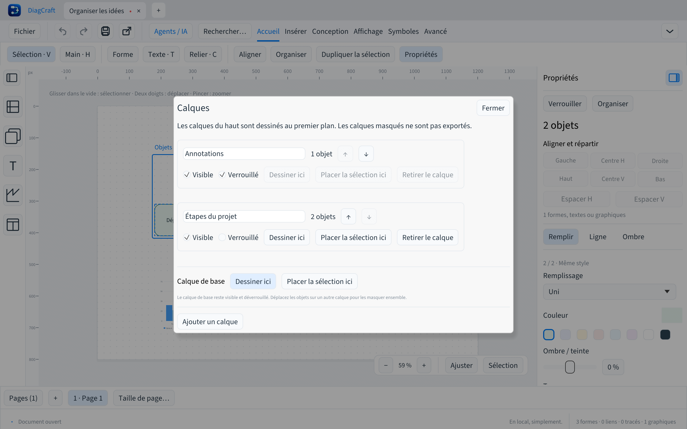

# Groupes, verrouillage et calques

DiagCraft 0.8.0 ajoute une organisation propre à chaque page. Les formes, textes,
graphiques, tracés et connecteurs conservent leurs identifiants et leurs positions.
Ces actions font partie de l’historique du dessin et de sa récupération locale.

## Travailler avec un groupe

Sélectionner plusieurs objets du même calque puis choisir **Grouper** dans
**Organiser** ou la palette de commandes. Les connecteurs internes admissibles
sont inclus. Un clic sur un membre sélectionne l’ensemble ; le déplacement et
la duplication conservent les écarts entre ses membres.

**Dégrouper** rend les membres indépendants sans déplacer leur contenu.
La première version utilise des groupes plats : regrouper plusieurs groupes
réunit leurs membres. Un groupe ne traverse pas plusieurs calques.
Le redimensionnement collectif et la rotation ne font pas partie de ce lot ;
dégrouper permet de redimensionner les membres individuellement.

Raccourcis : **Ctrl/⌘ G** pour grouper, **Ctrl/⌘ Maj G** pour dégrouper,
**Ctrl/⌘ L** pour verrouiller et **Ctrl/⌘ Maj L** pour déverrouiller.

## Protéger les éléments terminés

**Verrouiller** protège la sélection contre les changements de position, de
dimensions, de texte ou de style et contre la suppression. Les objets restent
sélectionnables pour l’inspection, la copie et le déverrouillage. Le verrouillage
d’un membre protège son groupe entier.

**Déverrouiller** libère les objets sélectionnés. Si leur calque est verrouillé,
il faut aussi déverrouiller ce calque. Les routes calculées des connecteurs
restent attachées aux formes lorsque leurs extrémités se déplacent.

## Organiser les calques

Ouvrir **Calques…** pour ajouter un calque, le renommer ou changer son ordre.
Les calques du haut passent devant ceux du bas. **Dessiner ici** choisit le
calque des prochains objets ; **Placer la sélection ici** y déplace un groupe
ou une sélection complète.

Un calque masqué disparaît de la feuille et des exports SVG/PDF, avec les
connecteurs qui dépendent de ses formes masquées. Son contenu reste enregistré.
Un calque verrouillé protège ses objets contre les modifications.

Le **calque de base** est toujours présent, visible et déverrouillé. Déplacer
des objets vers un autre calque permet de les masquer ou de les protéger
ensemble. Retirer un calque replace son contenu sur la base ; cela ne supprime
pas ses objets. Les groupes, calques et verrouillages sont indépendants d’une
page à l’autre.

Dupliquer sur une même page conserve les calques de destination et crée des
objets et groupes distincts. Les copies d’objets verrouillés sont déverrouillées ;
un calque de destination verrouillé doit être déverrouillé avant duplication.
Le collage depuis le presse-papiers importe des calques distincts et déverrouillés.

## Agents et compatibilité

L’inspection CLI/MCP expose l’organisation de chaque page. Les patches API 1
peuvent créer des calques, affecter les objets, grouper et verrouiller une
sélection. Un agent doit explicitement afficher ou déverrouiller les éléments
protégés avant d’en modifier le contenu. Un lot invalide est entièrement rejeté.
Voir le [guide des agents](AGENTS-DRAW.md).

Le format reste `.draw` v7, avec un champ facultatif `organization`. Les fichiers
sans organisation conservent leur comportement et leur sérialisation habituels.
Les versions antérieures à 0.8.0 ignorent ce champ : elles affichent les objets
masqués et ne conservent pas groupes, calques ou verrouillages au réenregistrement.
Pour conserver cette organisation, utiliser DiagCraft 0.8.0 ou ultérieur.
