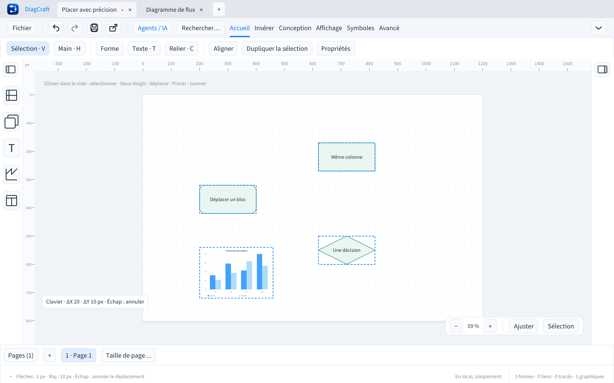

# Placer précisément au clavier

Sélectionner un ou plusieurs objets, puis utiliser les **flèches** pour les
déplacer de **1 pixel**. **Maj + flèches** déplace de **10 pixels**. Le pas reste
le même quel que soit le zoom et ne dépend pas du magnétisme de la grille.

Maintenir une touche crée un déplacement continu. L’indicateur sur la feuille
affiche le déplacement total **ΔX / ΔY**. Relâcher toutes les flèches termine
le geste : **Ctrl/⌘ Z** l’annule en une seule fois. Deux pressions séparées
restent deux étapes distinctes.

Pendant le geste, **Échap** ou **Ctrl/⌘ Z** restaure la position de départ, en
gardant la sélection, les modifications précédentes et la branche de rétablissement.
Un retour à la position initiale ne crée pas de modification dans l’historique.

Les objets sélectionnés reçoivent une translation commune, y compris les
graphiques, les tracés et les extrémités libres. Aux limites de page, le groupe
s’arrête ensemble : les écarts entre blocs et les longueurs des tracés restent
identiques. Les liens attachés suivent leurs blocs. Un lien attaché aux deux
extrémités ne se déplace pas seul avec ces commandes.

Un objet importé hors page peut revenir progressivement vers celle-ci sans
être replacé brutalement sur un autre axe. Les pages automatiques s’étendent
à la validation du geste ; l’annulation restaure aussi leur taille précédente.

Les quatre commandes **Déplacer la sélection…** se trouvent dans la palette
**Ctrl/⌘ K** et l’aide **F1**, sous **Placement**. Une commande exécutée depuis
la palette produit une étape d’annulation immédiate.

Les flèches restent disponibles pour déplacer le curseur dans les champs et
les blocs en cours de saisie, ainsi que pour parcourir les boîtes de dialogue.
Un clic, un changement de document, l’enregistrement ou une perte de focus
termine le déplacement en cours. Après une interruption, relâcher la flèche
avant de déplacer la nouvelle sélection. La récupération automatique attend
la fin du geste et n’enregistre pas une position intermédiaire annulée.

Cette amélioration couvre le placement au clavier ; les essais utilisateurs
sur MacBook 13 pouces et avec lecteurs d’écran restent prévus dans la feuille de route.
