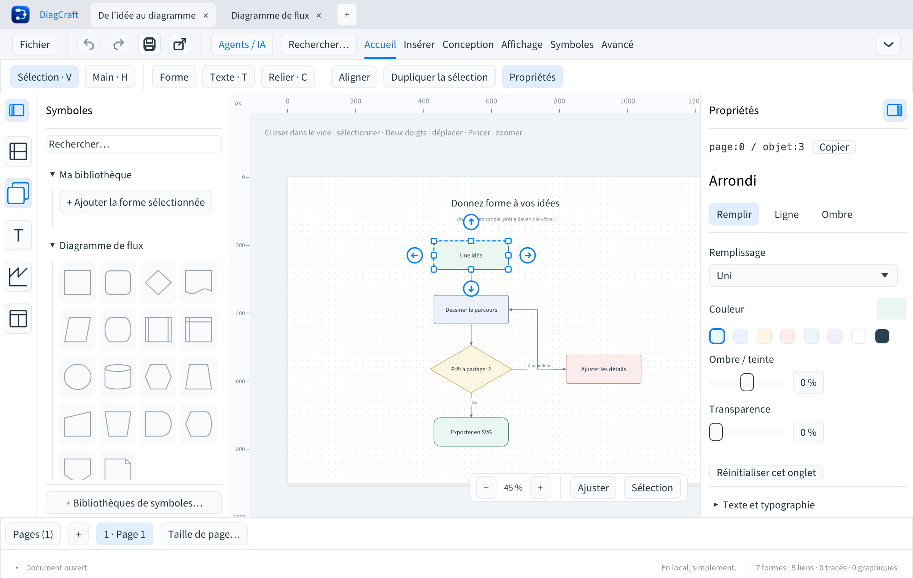

# DiagCraft

[English](../../README.md) · **Français** · [Deutsch](README.de.md) · [Español](README.es.md) · [Italiano](README.it.md) · [Português](README.pt.md) · [简体中文](README.zh-CN.md)

**Reliez vos idées.** Un éditeur de diagrammes natif, local et open source,
avec une interface en sept langues et une API pour les agents IA.

[](https://github.com/Kevin-FR/DiagCraft/actions/workflows/build.yml)
[](../../LICENSE)



## Télécharger

Les applications et leurs empreintes SHA-256 sont sur la page des
[releases](https://github.com/Kevin-FR/DiagCraft/releases).

| Plateforme | Paquet |
| --- | --- |
| macOS 13+, Apple Silicon | Application `.app` dans un ZIP ; CLI séparée |
| Windows x86_64 | ZIP portable avec application et CLI |
| Linux x86_64 | Paquet `.deb` amd64 ou archive `.tar.gz`, application et CLI |

**0.11.2 est expérimentale** et améliore les fenêtres de petite hauteur, les bibliothèques au clavier et les commandes de focus. Le paquet
Mac est signé ad hoc et n’est pas notarié par Apple. Les paquets Windows ne
sont pas signés avec un certificat éditeur. Voir [l’installation](../installation.md).

Les applications antérieures à 0.10.0 perdent les images embarquées au réenregistrement. Voir le [guide images et PNG](../images.md) pour les formats, raccourcis et limites.

Voir les guides [Mermaid](../mermaid.md) et [diagnostics agents](../diagnostics.md). Conservez le `.draw` comme source complète : Mermaid ne préserve pas tous les éléments visuels.

Passez entre les zones avec F6 / Maj+F6 ; voir le [guide clavier](../keyboard-navigation.md).

## Fonctions disponibles

- Import/export d’un sous-ensemble Mermaid documenté avec rapport et confirmation des pertes ; erreurs agents précisant opération, page, cible et piste de correction.
- Import PNG/JPEG, dépôt et commande de collage d’image ; export de pages ou sélections avec dimensions, résolution et transparence au choix.
- Les connecteurs à angle droit évitent les blocs et graphiques visibles en conservant points manuels, ports choisis et extrémités libres.
- Groupes persistants, verrouillage des objets et calques par page, avec visibilité commune sur la feuille et dans les exports SVG/PDF.
- Flèches : 1 px ; Maj : 10 px. Maintenir une touche crée un seul déplacement annulable, sans déformer la sélection.
- Une seule icône par volet, alignée sous le ruban et accessible quand le volet est fermé.
- Recherche des objets par texte, type ou identifiant ; création, édition et connexion de blocs au clavier.
- Texte modifiable directement dans les blocs : double-clic ou F2/Entrée, sélection de mots et barre flottante de mise en forme. Un clic à l’extérieur valide ; Échap annule.
- Interface anglais, français, allemand, espagnol, italien, portugais et chinois simplifié.
- Mises à jour GitHub facultatives, téléchargement vérifié SHA-256 et installation manuelle.
- Formes, textes, graphiques, huit bibliothèques de symboles et neuf modèles.
- Connecteurs liés aux blocs ou à extrémités libres, ports et coudes modifiables.
- Documents multipages, formats de papier, tailles personnalisées et ajustement au dessin.
- Remplissages, dégradés, motifs, contours, flèches et ombres.
- Sélection multiple, alignement, espacement, repères, annulation des gestes et historique.
- Navigation au trackpad, ruban compact par onglet et volets redimensionnables mémorisés.
- Palette de commandes avec ⌘K / Ctrl+K et aide clavier filtrable avec F1.
- Fichiers `.draw` éditables, galerie locale avec versions, exports SVG et PDF.
- Ajustement automatique des formes au texte, avec calcul partagé par le canevas et les exports SVG/PDF.
- Copies automatiques locales et récupération des dessins après un plantage, sans écraser les originaux.
- CLI et serveur MCP locaux : inspection, validation et patches JSON atomiques.

L’organisation est enregistrée dans des métadonnées v7 facultatives. Les anciennes applications affichent les objets masqués et perdent groupes, calques et verrouillages au réenregistrement.

[Groupes et calques](../organisation.md) (FR).

Le format de document **v7** et l’API agents **v1** ont leurs propres numéros,
indépendants de la version de l’application. Les fichiers des formats v1 à v6
sont migrés en mémoire à l’ouverture. La source reste intacte jusqu’à l’enregistrement.

Aucun compte ni clé API n’est nécessaire pour dessiner. Le serveur MCP travaille
dans un dossier local choisi ; l’application ne contacte pas de modèle IA.

La langue se choisit dans **Fichier → Langue et paramètres…**. Les textes des
dessins restent inchangés. Le paquet Mac contient uniquement du code `arm64` et
utilise les bibliothèques système macOS : **Rosetta n’est pas nécessaire**.
Voir [langues et mises à jour](../langues-et-mises-a-jour.md).

Voir [la recherche de commandes](../commandes.md), [le ruban et les volets](../interface.md)
et [les règles de version](../versioning.md).
Voir aussi [la récupération des dessins](../recuperation.md) et [l’ajustement du texte](../ajustement-texte.md).

[contenu des blocs](../contenu-blocs.md) (FR).
[recherche d’objets et parcours au clavier](../recherche-objets.md) (FR).

## Développer

Installer [Rust](https://rustup.rs/) et Python 3.11 ou ultérieur, puis :

```sh
git clone https://github.com/Kevin-FR/DiagCraft.git
cd DiagCraft
cargo run --locked -p diagcraft
cargo run --locked -p diagcraft-cli -- --help
```

Sur Debian/Ubuntu, les dépendances système de compilation sont indiquées dans
[le guide de développement](../development.md).

```sh
cargo fmt --all --check
cargo clippy --locked --workspace --all-targets -- -D warnings
cargo test --locked --workspace
cargo deny check licenses sources advisories
python3 scripts/check-publication.py
python3 scripts/check-locales.py
python3 -m unittest discover -s packaging -p 'test_*.py'
```

## Structure

| Dossier | Rôle |
| --- | --- |
| `crates/core` | Modèle, géométrie, pages, historique, SVG/PDF, galerie et API agents |
| `apps/diagcraft` | Application native egui/eframe |
| `apps/diagcraft-cli` | Exécutable console sans interface graphique |
| `assets` | Polices, marque et notices avec provenance et empreintes |
| `docs` | Architecture, formats, développement, sécurité et releases |
| `packaging` | Construction des paquets et collecte des licences par cible |
| `examples` | Documents de démonstration et de compatibilité du format |

Le moteur est partagé par l’interface, la CLI et MCP. Il ne dépend pas d’egui.
Voir [l’architecture](../architecture.md) et [les choix de bibliothèques](../dependencies.md).

Contrôles de qualité et parcours de test pour contribuer : [guide qualité](../quality.md).

## Contribuer

Les éléments à réaliser et leurs critères sont dans [ROADMAP.md](../../ROADMAP.md).
Les groupes, rotations, images, export PNG, routage autour des obstacles et
installateurs intégrés restent à développer. Le rendu SVG dépend des polices du lecteur.

Lire [CONTRIBUTING.md](../../CONTRIBUTING.md). Pour piloter un dessin avec un agent,
consulter [le contrat agents](../AGENTS-DRAW.md). Les vulnérabilités se signalent
selon [SECURITY.md](../../SECURITY.md).

## Licence et provenance

Le code du projet est sous [licence MIT](../../LICENSE). Les dépendances et polices
gardent leurs licences propres ; les notices sont conservées dans les paquets.
[THIRD_PARTY.md](../../THIRD_PARTY.md) décrit les attributions, et
[l’audit de publication](../licensing.md) explique les contrôles et leurs limites.

[Connector routing guide / Guide des connecteurs](../connecteurs.md).
