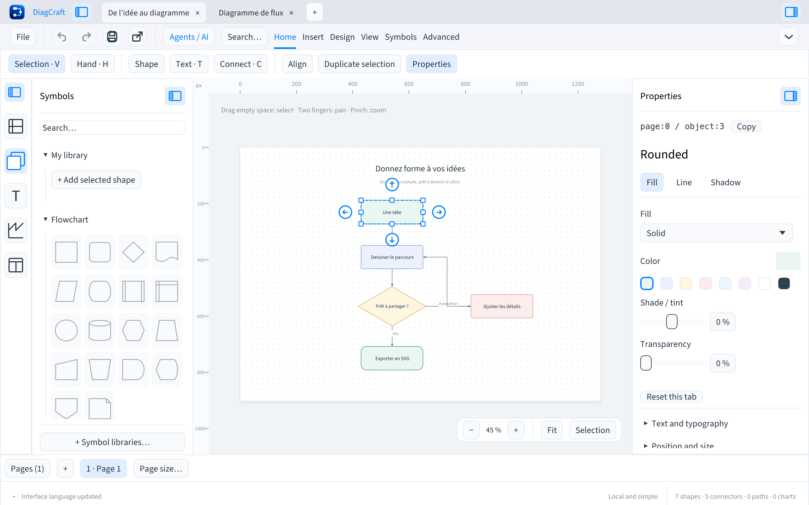

# DiagCraft

[English](../../README.md) · [Français](README.fr.md) · [Deutsch](README.de.md) · [Español](README.es.md) · **Italiano** · [Português](README.pt.md) · [简体中文](README.zh-CN.md)

**Collega le tue idee.** Un editor di diagrammi nativo, locale e open source,
con un’interfaccia in sette lingue e un’API per agenti IA.

[](https://github.com/Kevin-FR/DiagCraft/actions/workflows/build.yml)
[](../../LICENSE)



## Download

Le applicazioni e le relative somme di controllo SHA-256 sono disponibili nella
[pagina delle release](https://github.com/Kevin-FR/DiagCraft/releases).

| Piattaforma | Pacchetto |
| --- | --- |
| macOS 13+, Apple Silicon | Applicazione `.app` in un archivio ZIP; archivio CLI separato |
| Windows x86_64 | ZIP portatile con applicazione e CLI |
| Linux x86_64 | Pacchetto `.deb` per amd64 o archivio `.tar.gz`, con applicazione e CLI |

**0.11.1 è sperimentale** e migliora la navigazione da tastiera, il focus visibile e i controlli automatici di qualità.
Il pacchetto Mac ha una firma ad hoc e non è stato autenticato da Apple tramite
notarizzazione. I pacchetti Windows non sono firmati con un certificato dell’editore.
Consulta la [guida all’installazione](../installation.md).

Le applicazioni precedenti alla 0.10.0 eliminano le immagini incorporate al salvataggio. La [guida a immagini e PNG](../images.md) descrive formati, scorciatoie e limiti.

Consulta le guide a [Mermaid](../mermaid.md) e alla [diagnostica degli agenti](../diagnostics.md). Conserva `.draw` come fonte modificabile completa; Mermaid non preserva tutti i dettagli visivi.

Passa da un’area all’altra con F6 / Maiusc+F6: [guida alla tastiera](../keyboard-navigation.md).

## Funzionalità

- Importa/esporta un sottoinsieme Mermaid documentato con rapporto e conferma delle perdite; gli errori degli agenti indicano operazione, pagina, destinazione e suggerimento di correzione.
- Importa PNG/JPEG, trascina immagini o usa il comando dedicato per incollarle; esporta pagine o selezioni con dimensioni, risoluzione e trasparenza opzionale.
- I connettori ortogonali evitano blocchi e grafici visibili mantenendo punti manuali, porte scelte ed estremità libere.
- Gruppi persistenti, blocco degli oggetti e livelli per pagina, con visibilità condivisa tra area di disegno ed esportazioni SVG/PDF.
- Frecce: 1 px; Maiusc: 10 px. Tenere premuto un tasto crea un unico spostamento annullabile senza deformare la selezione.
- Un solo pulsante per pannello, allineato sotto la barra multifunzione e accessibile anche a pannello chiuso.
- Cerca oggetti nella pagina per testo, tipo o identificatore; inserisci, modifica e collega blocchi tramite tastiera.
- Modifica il testo direttamente nei blocchi: doppio clic o F2/Invio, selezione delle parole e barra di formattazione mobile. Un clic all’esterno conferma; Escape annulla.
- Interfaccia in inglese, francese, tedesco, spagnolo, italiano, portoghese e cinese semplificato.
- Controllo facoltativo degli aggiornamenti su GitHub, download verificati con SHA-256 e installazione manuale.
- Forme, testi, grafici, otto librerie di simboli e nove modelli.
- Connettori collegati alle forme o con estremità libere, punti di connessione e gomiti modificabili.
- Documenti multipagina, formati di carta, dimensioni personalizzate e adattamento al disegno.
- Riempimenti, sfumature, motivi, contorni, punte di freccia e ombre.
- Selezione multipla, allineamento, distribuzione, guide, annullamento dei gesti e cronologia delle modifiche.
- Navigazione con trackpad, barra multifunzione compatta a schede e pannelli ridimensionabili con preferenze salvate.
- Tavolozza dei comandi con ⌘K / Ctrl+K e guida da tastiera con ricerca tramite F1.
- File `.draw` modificabili, galleria locale dei progetti con versioni ed esportazione SVG/PDF.
- Adattamento automatico delle forme al testo, con misurazione dei font e disposizione condivisa tra interfaccia, SVG e PDF.
- Copie locali automatiche per il recupero dopo un arresto anomalo, senza sovrascrivere gli originali.
- CLI e server MCP locali: ispezione, validazione e patch JSON atomiche.

L'organizzazione è salvata in metadati v7 facoltativi. Le applicazioni precedenti mostrano gli oggetti nascosti e scartano gruppi, livelli e blocchi al salvataggio.

[Gruppi e livelli](../organisation.md) (FR).

Il formato dei documenti **v7** e l’API per agenti **v1** hanno numeri di versione
propri, indipendenti dall’applicazione. I file nei formati v1–v6 vengono migrati
in memoria all’apertura. Il file originale rimane invariato fino al salvataggio.

Per disegnare non servono account né chiavi API. Il server MCP lavora in una
cartella locale scelta dall’utente; l’applicazione non contatta modelli IA.

La lingua si sceglie in **File → Lingua e impostazioni…**. I testi dei disegni
rimangono invariati. Il pacchetto Mac contiene solo codice `arm64` e usa le
librerie di sistema macOS: **Rosetta non è necessario**.

Le guide dettagliate sono attualmente in francese:
[lingue e aggiornamenti](../langues-et-mises-a-jour.md), [comandi](../commandes.md),
[barra multifunzione e pannelli](../interface.md), [recupero](../recuperation.md)
[adattamento del testo](../ajustement-texte.md) e [gestione delle versioni](../versioning.md).

[contenuto dei blocchi](../contenu-blocs.md) (FR).
[ricerca di oggetti e uso della tastiera](../recherche-objets.md) (FR).

## Sviluppo

Installa [Rust](https://rustup.rs/) e Python 3.11 o successivo, quindi esegui:

```sh
git clone https://github.com/Kevin-FR/DiagCraft.git
cd DiagCraft
cargo run --locked -p diagcraft
cargo run --locked -p diagcraft-cli -- --help
```

Le dipendenze di sistema per compilare su Debian/Ubuntu sono elencate nella
[guida allo sviluppo](../development.md).

```sh
cargo fmt --all --check
cargo clippy --locked --workspace --all-targets -- -D warnings
cargo test --locked --workspace
cargo deny check licenses sources advisories
python3 scripts/check-publication.py
python3 scripts/check-locales.py
python3 -m unittest discover -s packaging -p 'test_*.py'
```

## Struttura del progetto

| Cartella | Funzione |
| --- | --- |
| `crates/core` | Modello dei documenti, geometria, pagine, cronologia, SVG/PDF, galleria e API per agenti |
| `apps/diagcraft` | Applicazione nativa egui/eframe |
| `apps/diagcraft-cli` | Eseguibile da console senza interfaccia grafica |
| `assets` | Font, identità visiva e avvisi di licenza con provenienza e somme di controllo |
| `docs` | Architettura, formati, sviluppo, sicurezza e release |
| `packaging` | Creazione dei pacchetti e raccolta delle licenze delle dipendenze per piattaforma |
| `examples` | Documenti dimostrativi e file di prova per la compatibilità del formato |

Interfaccia, CLI e MCP condividono lo stesso motore, che non dipende da egui.
Consulta l’[architettura](../architecture.md) e le [scelte delle librerie](../dependencies.md).

Controlli di qualità e scenari di prova per contribuire: [guida alla qualità](../quality.md).

## Contribuire

Le attività previste e i criteri di accettazione sono in [ROADMAP.md](../../ROADMAP.md).
Gruppi, rotazione, importazione di immagini, esportazione PNG, connettori che evitano
gli ostacoli e programmi di installazione integrati sono ancora da sviluppare.
La resa del testo SVG dipende dai font del visualizzatore.

Leggi [CONTRIBUTING.md](../../CONTRIBUTING.md). Per lavorare su un disegno con un
agente, consulta il [contratto per agenti](../AGENTS-DRAW.md). Segnala le vulnerabilità
come descritto in [SECURITY.md](../../SECURITY.md). Questi documenti sono attualmente in francese.

## Licenza e provenienza

Il codice del progetto è distribuito con [licenza MIT](../../LICENSE). Le dipendenze
e i font mantengono le proprie licenze; gli avvisi sono inclusi nei pacchetti.
[THIRD_PARTY.md](../../THIRD_PARTY.md) elenca le attribuzioni e l’[audit di pubblicazione](../licensing.md)
spiega i controlli e i loro limiti.

[Connector routing guide / Guide des connecteurs](../connecteurs.md).
