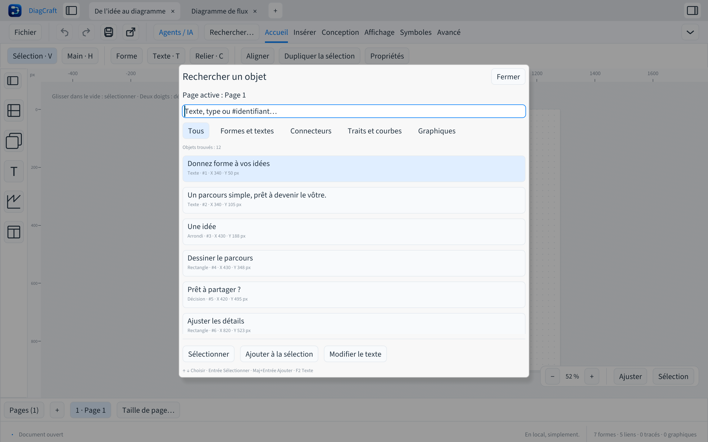

# Retrouver les objets et dessiner au clavier

Depuis **0.7.0**, **⌘F / Ctrl+F** ouvre **Rechercher un objet…** sur la page active.
La commande est aussi dans **Affichage** et dans la palette **⌘K / Ctrl+K**.
Elle donne accès aux formes, textes, connecteurs, traits, courbes et graphiques
sans occuper un volet permanent.

## Rejoindre un objet

Écrire une partie de son texte, son type ou son identifiant, par exemple `#12`.
La recherche accepte plusieurs mots, ignore les accents et les majuscules, et
prend aussi en compte les lignes suivantes d’un bloc. Les filtres limitent les
résultats aux formes et textes, connecteurs, traits et courbes ou graphiques.
Chaque ligne indique le type, l’ID et la position X/Y en pixels de document.

- **↑ / ↓** choisit un résultat quand le champ de recherche a le focus.
- **Entrée** ou un clic sélectionne l’objet et le rend visible.
- **Maj+Entrée**, Maj+clic ou **Ajouter à la sélection** conserve les objets déjà sélectionnés.
- **F2** ou **Modifier le texte** ouvre la saisie directement dans le bloc choisi.
- **Tab / Maj+Tab** parcourt les contrôles ; Entrée active le contrôle qui a le focus.
- **Échap** ou **Fermer** revient à la feuille avec la sélection et la vue précédentes.

Le zoom est conservé lorsque l’objet tient dans la fenêtre ; la vue se déplace
seulement si nécessaire. Un objet plus grand utilise le cadrage de la sélection. La recherche, les filtres
et la navigation ne modifient ni le fichier ni l’historique d’annulation.
Les textes des dessins restent dans leur langue d’origine.

La liste n’affiche que les lignes visibles. Les longues étiquettes sont tronquées
dans la liste ; leur contenu complet reste éditable dans le bloc. Une modification
externe du document rafraîchit les résultats avant toute sélection ; changer de
page ou de document ferme la recherche.

## Créer, nommer et relier sans souris

1. **R**, puis **Entrée** place un rectangle dans la zone visible et sélectionne
   son texte. **T**, puis **Entrée** fait de même pour un texte libre. On peut aussi
   choisir une forme ou un symbole puis utiliser **Placer la forme dans la vue**.
2. Écrire son contenu. **⌘Entrée / Ctrl+Entrée** termine ; **Entrée** ajoute une ligne.
3. **⌘F / Ctrl+F**, rechercher le premier bloc puis **Entrée** le sélectionne.
4. Relancer la recherche pour le second bloc, puis **Maj+Entrée** l’ajoute.
5. **C** relie les deux blocs, dans l’ordre de leur sélection. Une annulation
   supprime ce lien sans modifier les blocs.

Le placement préfère un espace libre près du centre visible, puis sur la page.
Il conserve les objets existants et les styles des symboles. Une page remplie
peut nécessiter de déplacer la nouvelle forme avec les flèches : **1 px** par
pression, **10 px** avec Maj. **Maj+F** cadre la sélection et **F** revoit la page.

La création d’une forme et la validation de son texte sont deux modifications
annulables. Échap pendant la saisie conserve la forme avec son contenu initial.
**⌘S / Ctrl+S** enregistre ; **⌘O / Ctrl+O** rouvre un dessin et les commandes
d’export restent accessibles dans la palette. Sur un Mac aux touches multimédias,
utiliser **fn+F2** pour modifier le texte.

Ce parcours prépare les essais au clavier de la feuille de route. Les tests
utilisateurs et l’évaluation complète avec des lecteurs d’écran restent à réaliser.
