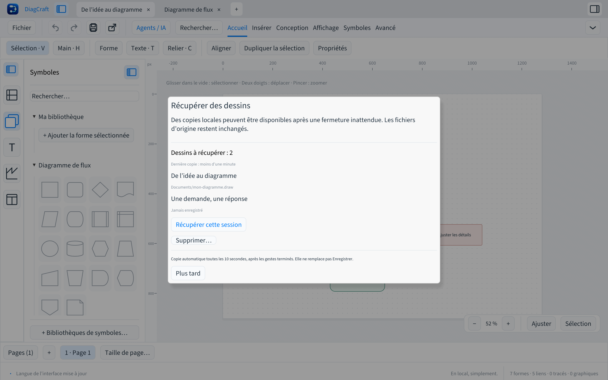

# Récupérer ses dessins

DiagCraft 0.4.0 conserve automatiquement une copie locale des documents modifiés,
y compris les onglets jamais enregistrés. Toutes les dix secondes, après les gestes
terminés, un worker écrit une copie atomique contenant toutes les pages, formes,
textes, styles et connecteurs. Les fichiers `.draw` d’origine restent intacts.

Après une fermeture inattendue, le lancement suivant propose **Récupérer des dessins**.
La liste indique les titres et les anciens emplacements, ou **Jamais enregistré**.
**Récupérer cette session** ouvre ses dessins dans de nouveaux onglets marqués
non enregistrés. **Enregistrer** demande un emplacement pour chaque copie ; aucun
fichier d’origine n’est remplacé automatiquement.

**Plus tard** ou Échap conserve les copies pour un prochain lancement. Le dialogue
reste accessible depuis **Fichier → Récupérer des dessins…** ou la palette ⌘K / Ctrl+K.
Pour supprimer des copies, choisir **Supprimer…** puis confirmer. Une copie illisible
ou créée par une version plus récente est conservée tant que vous ne la supprimez pas.

Les instances ouvertes ont chacune un verrou système : elles ne récupèrent pas les
documents encore utilisés par une autre instance. Après récupération, l’ancienne copie
n’est supprimée qu’après confirmation de l’écriture de la nouvelle. Une fermeture
normale acceptée efface les copies de la session courante ; les sessions laissées
pour plus tard sont conservées.

## Emplacement et limites

Les copies sont dans `recovery-v1`, à côté de la bibliothèque locale :

- macOS : `~/Library/Application Support/DiagCraft/recovery-v1`.
- Windows : `%APPDATA%/DiagCraft/recovery-v1`.
- Linux : `$XDG_DATA_HOME/diagcraft/recovery-v1`, ou `~/.local/share/diagcraft/recovery-v1`.

Une installation ancienne peut conserver son dossier de données historique.
Les copies restent sur cet ordinateur et ne sont pas envoyées à GitHub ni à un agent IA.
Le worker ne conserve qu’une génération par session, dans `snapshot.json` ; ce fichier
est une enveloppe interne, pas un nouveau format d’échange. Utiliser **Enregistrer**
pour obtenir un `.draw` portable. Les sources et chemins indiqués dans les copies
sont des données ; la récupération ne les ouvre ni ne les exécute.

La dernière tranche de dix secondes et un geste inachevé peuvent être perdus lors
d’un arrêt brutal. La copie de récupération ne remplace pas les enregistrements
volontaires ni les versions de la galerie. Une erreur d’écriture est signalée et
la copie précédente reste conservée.

Un checkpoint est limité à 100 documents et 64 Mio. Au lancement, la lecture est
bornée à 32 sessions et 128 Mio cumulés ; les fichiers supplémentaires restent sur
disque pour les lancements suivants. En cas de fermeture système immédiate pendant
le nettoyage, une copie déjà enregistrée peut être proposée à nouveau sans altérer
le fichier source.
