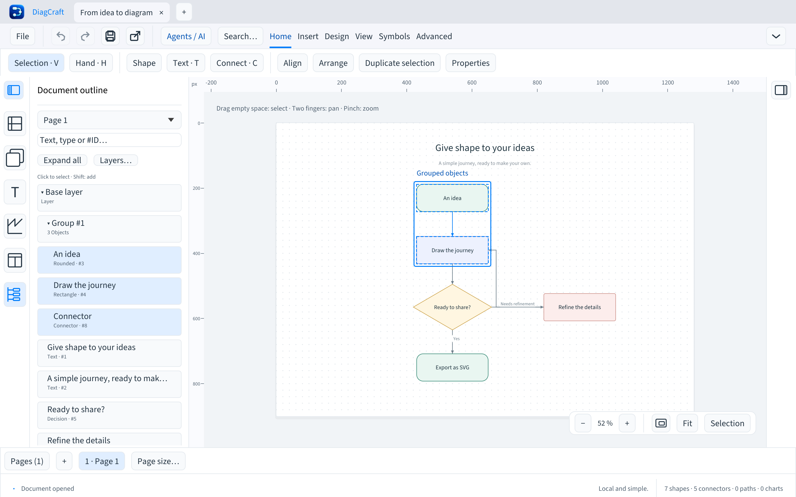

# Structure du document

Première version disponible dans la branche de développement, non distribuée.
Ouvrez l’icône d’arborescence dans le rail gauche ou cherchez **Structure du
document** dans la palette Cmd/Ctrl+K. Elle réutilise le volet gauche ; son bouton
de réduction reste disponible. F6 / Maj+F6 atteignent cette zone comme les autres
vues de la bibliothèque.

Le sélecteur supérieur change de page. La liste montre les calques, les groupes
et tous les objets de la page active : formes, textes, images, connecteurs,
tracés et graphiques. Chaque objet possède un aperçu de nom, un type et son ID.
Les états **Masqué** et **Verrouillé** sont indiqués. Les IDs de groupes et de
calques appartiennent à des espaces différents de ceux des objets.

- Cliquez sur un calque ou un groupe pour replier/développer sa branche.
- Cherchez un nom, un type ou un `#identifiant`. La recherche ignore les accents
  et conserve les ancêtres des résultats, même s’ils étaient repliés. Un nom de
  calque ou de groupe correspondant révèle aussi ses descendants. Effacez le
  filtre avec **Effacer la recherche**.
- Cliquez sur un objet, ou focalisez-le puis appuyez sur Entrée, pour le sélectionner
  et le rendre visible sur la feuille. Maj ajoute à la sélection ; les membres
  d’un groupe restent sélectionnés ensemble. Les objets verrouillés visibles
  peuvent être sélectionnés pour inspection, avec les protections habituelles.
- Les objets masqués sont listés mais ne sont pas sélectionnés. Utilisez **Calques…**
  pour afficher le calque concerné ; le navigateur n’altère pas la visibilité.
- Flèches Haut/Bas parcourent les lignes, même hors écran. Gauche replie une
  branche ou rejoint son parent ; Droite développe une branche. Dans la recherche,
  les touches restent celles d’un champ de texte.
- **Montrer la sélection** efface le filtre, développe les branches parentes et
  place le focus sur un objet sélectionné visible, sans modifier le dessin.
- **Tout replier** ferme les calques et groupes ; **Tout développer** les réouvre.
  Le repli global est désactivé pendant une recherche, qui affiche ses résultats
  même dans les branches repliées.

La liste peint seulement ses lignes visibles. Ses noms et filtres se limitent aux
80 premiers caractères des noms/textes ; Cmd/Ctrl+F conserve la recherche complète
des contenus sur la page. Cette version n’affiche pas toutes les pages en arbre
simultanément et ne renomme ni ne réordonne les objets par glisser-déposer.

Sélection, navigation et repli ne modifient ni le dessin ni son historique, y
compris une branche de rétablissement. Les recherches et replis ne sont pas
sauvegardés. Au prochain lancement, le navigateur revient à la vue Symboles ;
les préférences existantes restent compatibles avec les anciennes versions.
Le format `.draw` reste v7 et l’API agents v1.

Les tests couvrent groupes, protections, sélection additive, recherche, changements
de page, sept langues et parcours clavier d’une liste de 2 000 objets. Les essais
avec lecteurs d’écran et utilisateurs restent prévus avant la 1.0.
